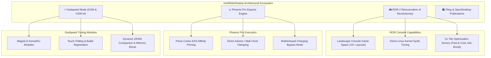

<div align="center">

  

  <p align="center">
    <a href="https://github.com/revws">
      
    </a>
  </p>

  <p align="center">
    <a href="https://github.com/revws"></a>
    <a href="https://t.me/godTspeed"></a>
    <a href="https://t.me/godspeedmode"></a>
    <a href="https://t.me/revwhiteshadow"></a>
    <a href="https://www.pling.com/u/revwhiteshadow"></a>
    <a href="https://www.opendesktop.org/u/revwhiteshadow"></a>
    <a href="http://ko-fi.com/revWS"></a>
  </p>

  <p align="center">
    
    
    
    
    
  </p>

</div>

---

### ⚡ Architectural Philosophy & About Me

I am **revWhiteShadow** (widely known across developer and esports communities as **revWS**), an autonomous systems architect, Linux kernel optimization researcher, and esports mobile software developer.

My work focuses on eliminating OEM performance bottlenecks, mitigating conservative DVFS thermal throttling curves, and engineering deterministic, jitter-free **60, 90, 120, and 144 FPS** frame pacing for competitive mobile gamers and power users.

```
+----------------------------------------------------------------------------------------------------+
|                                      THE CORE MISSION                                              |
+----------------------------------------------------------------------------------------------------+
|  1. ELIMINATE JITTER        | 2. BYPASS THERMALS         | 3. MAXIMIZE RESPONSIVENESS              |
|  Pin game rendering loops   | Toggle motherboard power   | Accelerate touch digitizer sampling     |
|  exclusively to Prime EAS   | directly, isolating        | and synchronize IMU gyroscope buffers    |
|  clusters for 0% drops.     | battery heat generation.   | for sub-millisecond bullet accuracy.    |
+----------------------------------------------------------------------------------------------------+
```

- 🎮 **Lead Architect**: **[ROR (Reincarnation of Revolutionary)](https://github.com/revws/ror)** — The autonomous Android Game Launcher, landscape console experience, live Linux kernel governor suite, and 21-tile gaming armory.
- 🔥 **Creator**: **Phoenix Pro Performance Engine** — Sub-millisecond execution loops, EAS Prime core affinity locking, hardware-accelerated FPS crosshair armory, and low-latency IMU sensor poll buffers.
- ⚡ **Creator**: **Godspeed Mode (GSM / GSM AI / Resurrect of Madness)** — Legendary high-performance Magisk modules, kernel tuning packages, and Android system optimization scripts distributed across Telegram, OpenDesktop, and Pling.
- 🛡️ **Absolute Privacy Commitment**: Strict refusal of commercial spyware. Zero analytical trackers, zero advertisement SDKs, and zero background telemetry across all projects.
- 📱 **Forward Compatibility Engineering**: Architected to execute flawlessly on **Android 10 (API 29) through Android 17 (API 37) and all future upcoming Android releases**.

---

### 🛠️ Low-Level Systems & Technical Arsenal

<div align="center">

| Domain | Low-Level Subsystems & Kernel Primitives | Target Architectures |
| :--- | :--- | :--- |
| **Linux Kernel Optimization** | Direct `sysfs`/`procfs` read/write, EAS (Energy-Aware Scheduling), CPU governors (`schedutil`, `walt`, `performance`, `interactive`, `blu_schedutil`), I/O schedulers (`mq-deadline`, `bfq`, `kyber`), `vfs_cache_pressure`, dirty writebacks | ARM64 (`arm64-v8a`), 32-bit (`armeabi-v7a`), x86_64 |
| **GPU Frequency Scaling** | Qualcomm Adreno (`kgsl-3d0`) frequency tables & bus scaling, ARM Mali `devfreq` governor clamping, thermal mitigation override | Qualcomm Snapdragon 845 &rarr; 8 Gen 3/4, MediaTek Dimensity 700 &rarr; 9400+ |
| **Android OS Engineering** | AOSP Internals (API 29 through 37+), Android WindowManager overlays, AIDL Binder IPC, Shizuku dynamic token exchange, Android Low Memory Killer (LMK) overrides | Android 10, 11, 12/12L, 13, 14, 15, 16, 17+ |
| **Root & Privilege Engines** | TopJohnWu's `libsu` isolated daemon bridge, Magisk modules, KernelSU kernel hooks, APatch kernel patching | Linux Kernels 4.14, 4.19, 5.4, 5.10, 5.15, 6.1, 6.6+ GKI |
| **Hardware Thermal & Battery** | Motherboard charging bypass (`charging_enabled = 0`), real-time battery milliamp discharge telemetry, automatic thermal cut-offs at 47°C | Dual-cell, Li-Po, Fast Charge protocols |
| **Esports Input Stabilization** | IMU sensor buffer acceleration, digitizer touch sampling boosts, dynamic crosshair HUD reticles | Competitive FPS titles (PUBG, BGMI, COD:M, Apex) |

</div>

#### Languages & Core Technologies
<p align="center">
  
  
  
  
  
  
  
  
</p>

---

### 🚀 Flagship Projects & Ecosystem Architecture



#### 1. [ROR • Reincarnation of Revolutionary](https://github.com/revws/ror)
*The Next-Generation Android Gaming Console, Linux Kernel Manager & Thermal Platform*
- **Landscape Console Game Space**: Dynamic game library carousel with per-game governor bindings, refresh rate forcing (60/90/120/144Hz), and in-game floating overlay HUD.
- **Direct Linux Kernel Governor Tuning**: Real-time read/write control over `schedutil`, `walt`, `performance`, `interactive`, and `conservative` governors across LITTLE, BIG, and PRIME core clusters.
- **21-Tile Optimization Armory**: Fast & Cool thermal shedder, Aim Boost hardware crosshairs, Gyro Delay Fix, low-overhead MediaCodec screen recorder, and Charging Cooldown bypass.
- **Universal Privilege Adaptability**: Fully operational with Magisk, KernelSU, APatch, Shizuku (non-root elevated binder), or standard userspace.

#### 2. Phoenix Pro Performance Suite
*Esports Tournament-Grade Sub-Millisecond Execution Loop*
- EAS core affinity locking that anchors game render loops exclusively on Gold/Prime Cortex cores.
- Direct GPU frequency clamping on Qualcomm Adreno (`kgsl-3d0`) and ARM Mali devfreq power nodes.
- Hardware charging bypass toggling motherboard power directly, preventing battery thermal build-up.

#### 3. Godspeed Mode (GSM, GSM AI & Resurrect of Madness)
*Legendary Android Performance Packages & Kernel Tweaks*
- Community-celebrated Magisk / KernelSU modules engineered for competitive battle royales (PUBG Mobile, BGMI, Call of Duty: Mobile).
- Custom dynamic governor switching, input boost frequency scaling, and touch digitizer response acceleration.
- GS ZRAM & RAM compaction algorithms preventing frame-time micro-stutters.

#### 4. [OpenDesktop & Pling Store Creations](https://www.pling.com/u/revwhiteshadow)
*System Mods, Custom Wallpapers, Performance Scripts & Emulation Tools*
- Official publications on [Pling.com](https://www.pling.com/u/revwhiteshadow) and [OpenDesktop.org](https://www.opendesktop.org/u/revwhiteshadow).
- Verified developer sharing Android customization scripts, thermal profiles, wallpapers, and system aesthetics.

---

### 📊 Live GitHub Activity & Performance Telemetry

<div align="center">
  
  
</div>

<div align="center">
  
</div>

<div align="center">
  
</div>

---

### 🌐 Official Channels, Community & Store Links

<div align="center">

| Platform / Channel | Purpose | Direct Destination |
| :--- | :--- | :--- |
| 📢 **Official Channel** | Firmware releases, module announcements & updates | [t.me/godTspeed](https://t.me/godTspeed) |
| 💬 **Community Discussion** | Technical support, benchmark sharing & hardware feedback | [t.me/godspeedmode](https://t.me/godspeedmode) |
| 👤 **Telegram Direct** | Direct inquiries & developer contact | [@revwhiteshadow](https://t.me/revwhiteshadow) |
| 🌐 **Official ROR Source** | Official ROR repository on GitHub | [github.com/revws/ror](https://github.com/revws/ror) |
| 🧪 **Experimental Repo** | Public experimental staging & testing builds | [github.com/revws/rorexp](https://github.com/revws/rorexp) |
| 🛍️ **Pling Store Profile** | Official scripts, system mods, and Android releases | [pling.com/u/revwhiteshadow](https://www.pling.com/u/revwhiteshadow) |
| 🖥️ **OpenDesktop Profile** | Open-source desktop & mobile performance projects | [opendesktop.org/u/revwhiteshadow](https://www.opendesktop.org/u/revwhiteshadow) |
| ☕ **Ko-fi Donations** | Support independent, ad-free systems development | [ko-fi.com/revWS](http://ko-fi.com/revWS) |

</div>

---

<div align="center">
  <sub>Engineered with passion for competitive mobile gamers, kernel tuners, and power users. &copy; revWhiteShadow.</sub>
</div>
