<div align="center">

  

  <p align="center">
    <a href="https://github.com/revws">
      
    </a>
  </p>

  <p align="center">
    <a href="https://github.com/revws"></a>
    <a href="https://revwhiteshadow.gitlab.io"></a>
    <a href="https://gitlab.com/revWhiteShadow"></a>
    <a href="https://t.me/godTspeed"></a>
    <a href="https://t.me/godspeedmode"></a>
    <a href="https://t.me/revwhiteshadow"></a>
    <a href="https://www.pling.com/u/revwhiteshadow"></a>
    <a href="https://www.opendesktop.org/u/revwhiteshadow"></a>
    <a href="http://ko-fi.com/revWS"></a>
  </p>

  <p align="center">
    
    
    
    
    
    
    
  </p>

</div>

---

### ⚡ Terminal Identity & Architectural Manifesto

```bash
┌──(root㉿revWS)-[~]
└─$ whoami --verbose
```

> **"Fast. Clean. Optimized. Smart tech shouldn't be locked down."**
> 
> As-salamu Alaykum! I am **revWhiteShadow** (known across developer and esports communities as **revWS**), an autonomous systems architect, Linux kernel optimization researcher, Android developer, and cybersecurity analyst from **Bangladesh 🇧🇩**.
> 
> The **"rev"** in my name stands for **Revolutionary** — *because I don't just follow trends, I break barriers and redefine them.*
> 
> My engineering focuses on eradicating OEM performance throttling, unlocking deterministic **60 / 90 / 120 / 144 FPS** frame pacing, optimizing Linux kernels for low-end laptops and servers, and hardening mobile and web application security through ethical penetration testing.

```
+----------------------------------------------------------------------------------------------------+
|                                    CORE ENGINEERING TENETS                                         |
+----------------------------------------------------------------------------------------------------+
|  1. ELIMINATE JITTER        | 2. BYPASS THERMALS         | 3. HARDEN SECURITY                      |
|  Pin game rendering loops   | Toggle motherboard power   | Responsible vulnerability disclosure,   |
|  exclusively to Prime EAS   | directly, isolating        | penetration testing, and zero-telemetry  |
|  clusters for 0% drops.     | battery heat generation.   | architecture across all releases.       |
+----------------------------------------------------------------------------------------------------+
```

- 🎮 **Lead Architect**: **[ROR (Reincarnation of Revolutionary)](https://github.com/revws/ror)** — The autonomous Android gaming console launcher, landscape interface, live Linux kernel governor suite, and 21-tile gaming armory.
- 🔥 **Creator**: **Phoenix Pro Performance Engine** — Sub-millisecond execution loop, Prime EAS core affinity locking, hardware-accelerated FPS crosshairs, and low-latency IMU sensor poll buffers.
- 🐧 **Creator**: **[Linuxar](https://revwhiteshadow.gitlab.io/post/linuxar/)** — Lightweight terminal kernel optimizer engineered to squeeze maximum responsiveness and performance out of low-end hardware, laptops, and Linux distros.
- ⚡ **Creator**: **Godspeed Mode (GSM / GSM AI / Resurrect of Madness)** — Legendary high-performance Magisk & KernelSU modules and system optimization scripts distributed across Telegram, OpenDesktop, and Pling.
- 🛡️ **Cybersecurity & Bug Hunting**: Independent penetration tester and ethical hacker utilizing Kali Linux, Burp Suite, and OWASP ZAP for vulnerability research and application auditing.
- 🛡️ **Absolute Privacy Commitment**: Strict refusal of commercial spyware. Zero analytical trackers, zero advertisement SDKs, and zero background telemetry across all software.
- 📱 **Forward Compatibility Engineering**: Architected to execute flawlessly across **Android 10 (API 29) through Android 17 (API 37) and all future upcoming Android releases**.

---

### 💻 Tech Stack & Technical Arsenal

<div align="center">
  <a href="https://skillicons.dev">
    
  </a>
</div>

<br />

<div align="center">

| Subsystem Domain | Low-Level Technologies, Primitives & Kernel Architecture | Target Platforms & Environments |
| :--- | :--- | :--- |
| **🐧 Linux Kernel Optimization** | Direct `sysfs`/`procfs` read/write, EAS (Energy-Aware Scheduling), CPU governors (`schedutil`, `walt`, `performance`, `interactive`, `blu_schedutil`), I/O schedulers (`mq-deadline`, `bfq`, `kyber`), `vfs_cache_pressure`, dirty writebacks, kernel parameter tuning | ARM64 (`arm64-v8a`), 32-bit (`armeabi-v7a`), x86_64, Linux Kernels 4.14 through 6.6+ GKI |
| **🎮 GPU & Thermal Mitigation** | Qualcomm Adreno (`kgsl-3d0`) bus scaling & frequency tables, ARM Mali `devfreq` governor clamping, hardware motherboard charging bypass (`charging_enabled = 0`) | Qualcomm Snapdragon 845 &rarr; 8 Gen 3/4, MediaTek Dimensity 700 &rarr; 9400+ |
| **📱 Android OS Engineering** | AOSP Internals (API 29 to 37+), Android WindowManager overlays, AIDL Binder IPC, Shizuku dynamic token exchange, Android Low Memory Killer (LMK) overrides | Android 10, 11, 12/12L, 13, 14, 15, 16, 17+ |
| **⚡ Superuser & Privilege Engines** | TopJohnWu's `libsu` isolated daemon bridge, Magisk modules, KernelSU kernel hooks, APatch kernel patching | Rooted & Elevated Android ecosystems |
| **🛡️ Cybersecurity & Pentesting** | Penetration testing, network vulnerability scanning, exploit analysis, bug hunting (XSS, SQLi, CSRF, auth flaws) | Kali Linux, Kali NetHunter, Burp Suite, Nmap, Wireshark, OWASP ZAP, Metasploit, Hydra |
| **🌐 Virtualization & Server Systems** | SR-IOV BIOS/UEFI virtualization, Docker containerization & USB smart card hotplug, PCSX2 emulation architecture, Ubuntu Server kernel tuning, Hugo static generation | Ubuntu 24.04/25.10, Debian, Arch Linux, Docker, VPS |
| **🎯 Esports Input Stabilization** | IMU sensor buffer acceleration, digitizer touch sampling boosts, dynamic hardware crosshair HUD reticles | Competitive FPS titles (PUBG, BGMI, COD:M, Apex) |

</div>

---

### 🚀 Featured Projects & Ecosystem Architecture

```mermaid
graph TD
    subgraph Core_Ecosystem ["revWhiteShadow Architectural Ecosystem"]
        direction TB
        ROR["🎮 ROR // Reincarnation of Revolutionary"]
        PHX["🔥 Phoenix Pro Esports Engine"]
        GSM["⚡ Godspeed Mode (GSM & GSM AI)"]
        LXR["🐧 Linuxar Kernel Optimizer"]
        STORE["🛍️ Pling & OpenDesktop Publications"]
    end

    subgraph ROR_Components ["ROR Console Capabilities"]
        GS["Landscape Console Game Space (10+ Layouts)"]
        KT["Direct Linux Kernel Sysfs Tuning"]
        ARM["21-Tile Optimization Armory (Fast & Cool, Aim Boost)"]
    end

    subgraph Phoenix_Components ["Phoenix Pro Execution"]
        AFF["Prime Cortex EAS Affinity Pinning"]
        GPU["Direct Adreno / Mali Clock Clamping"]
        BYPASS["Motherboard Charging Bypass Mode"]
    end

    subgraph Linuxar_Components ["Linuxar System Primitives"]
        KTUNE["Kernel Parameter Dynamic Tuning"]
        LAPTOP["Low-End Laptop & Server Responsiveness"]
        DEB["Debian / Ubuntu / Arch Adapters"]
    end

    subgraph GSM_Components ["Godspeed Tuning Modules"]
        MOD["Magisk & KernelSU Modules"]
        TOUCH["Touch Polling & Bullet Registration"]
        ZRAM["Dynamic ZRAM Compaction & Memory Boost"]
    end

    ROR --> GS
    ROR --> KT
    ROR --> ARM
    PHX --> AFF
    PHX --> GPU
    PHX --> BYPASS
    LXR --> KTUNE
    LXR --> LAPTOP
    LXR --> DEB
    GSM --> MOD
    GSM --> TOUCH
    GSM --> ZRAM
```



#### 1. [ROR • Reincarnation of Revolutionary](https://github.com/revws/ror)
*The Next-Generation Android Gaming Console, Linux Kernel Manager & Thermal Platform*
- **Landscape Console Game Space**: Dynamic game library carousel with per-game governor bindings, refresh rate forcing (60/90/120/144Hz), and in-game floating overlay HUD.
- **Direct Linux Kernel Governor Tuning**: Real-time read/write control over `schedutil`, `walt`, `performance`, `interactive`, and `conservative` governors across LITTLE, BIG, and PRIME core clusters.
- **21-Tile Optimization Armory**: Fast & Cool thermal shedder, Aim Boost hardware crosshairs, Gyro Delay Fix, low-overhead MediaCodec screen recorder, and Charging Cooldown bypass.
- **Universal Privilege Adaptability**: Fully operational with Magisk, KernelSU, APatch, Shizuku (non-root elevated binder), or standard userspace.

#### 2. Phoenix Pro Performance Suite
*Esports Tournament-Grade Sub-Millisecond Execution Loop*
- **EAS Core Affinity Locking**: Anchors game render loops exclusively on Gold/Prime Cortex cores to prevent thread migration frame drops.
- **Direct GPU Clamping**: Real-time frequency control over Qualcomm Adreno (`kgsl-3d0`) and ARM Mali `devfreq` power nodes.
- **Motherboard Charging Bypass**: Direct power routing bypassing the battery, preventing overheating and thermal throttling during intense gameplay.

#### 3. [Linuxar • Lightweight Linux Kernel Optimizer](https://revwhiteshadow.gitlab.io/post/linuxar/)
*Streamlined Terminal Utility for Low-End Laptops, Servers, and Workstations*
- **Kernel-Level Optimizations**: Activates targeted sysctl and kernel-level performance tweaks to maximize system responsiveness.
- **Broad Distribution Compatibility**: Seamlessly adapts to Ubuntu, Debian, Arch Linux, and generic Linux systems.
- **Universal Packaging**: Available as Debian (`.deb`) and standalone tarball (`.tar.gz`) on [Pling](https://www.pling.com/u/revwhiteshadow).

#### 4. Godspeed Mode (GSM, GSM AI & Resurrect of Madness)
*Legendary Android Performance Packages & Kernel Tweaks*
- Celebrated Magisk / KernelSU modules engineered for competitive battle royales (PUBG Mobile, BGMI, Call of Duty: Mobile).
- Custom dynamic governor switching, touch digitizer response acceleration, and IMU gyro buffer syncing.
- Dynamic ZRAM compaction algorithms preventing frame-time micro-stutters and memory thrashing.

#### 5. Additional System Tools & Security Environments
- **[Magisk-KernelSU-Template](https://gitlab.com/revWhiteShadow)**: High-performance starter framework for crafting Android system and kernel modules.
- **Windows Storage Cleaner**: Automated utility for deep system maintenance, junk file purging, and drive space optimization.
- **Kali NetHunter Termux**: Mobile penetration testing and offensive cybersecurity research playground.
- **Google Photos Unlimited Backup Spoofer**: Android system property spoofing module for automated backup compatibility.

---

### 📝 Technical Publications & Research Insights

Articles, guides, and engineering documentation published on [revwhiteshadow.gitlab.io](https://revwhiteshadow.gitlab.io):

<div align="center">

| Title & Topic | Description | Domain |
| :--- | :--- | :--- |
| 🐧 **[Linuxar: Lightweight Kernel Optimizer](https://revwhiteshadow.gitlab.io/post/linuxar/)** | Activating kernel-level parameters to boost low-end laptop responsiveness | Linux Kernel Tuning |
| ⚡ **[Godspeed Mode Deep-Dive](https://revwhiteshadow.gitlab.io/post/godspeed-mode/)** | Android performance boosting through minimal, power-packed Magisk modules | Android Modding |
| 🐳 **[Docker USB Smart Card Hotplug Fix](https://revwhiteshadow.gitlab.io/blog/usb-smart-card-reader-hotplug-not-working-in-docker-container/)** | Troubleshooting container device pass-through, udev rules, and network mode | Containerization |
| 🖧 **[Enabling SR-IOV in Motherboard BIOS/UEFI](https://revwhiteshadow.gitlab.io/blog/how-to-enable-sr-iov-from-the-bios-uefi-firmware-of-your-motherboard/)** | Unlocking Single Root I/O Virtualization for direct PCIe device passthrough | Virtualization & Servers |
| 🎮 **[Installing Steam on Ubuntu 24.04](https://revwhiteshadow.gitlab.io/blog/how-to-install-steam-on-ubuntu-2404/)** | Multi-method gaming guide for seamless Linux gaming setup | Linux Gaming |
| 📦 **[wget Removed from Ubuntu Server 25.10](https://revwhiteshadow.gitlab.io/blog/wget-removed-from-ubuntu-server-2510-default-install/)** | Transitioning from wget to wcurl in modern Ubuntu Server installations | Linux Systems |

</div>

---

### 📊 Live GitHub Activity & Performance Telemetry

<div align="center">
  
  
</div>

<div align="center">
  
</div>

<div align="center">
  
</div>

---

### 🌐 Official Channels, Community & Store Links

<div align="center">

| Platform / Channel | Purpose & Scope | Direct Link |
| :--- | :--- | :--- |
| 🌐 **Personal Website & Portfolio** | Official articles, guides, and project portal | [revwhiteshadow.gitlab.io](https://revwhiteshadow.gitlab.io) |
| 🦊 **GitLab Profile** | Source repositories, web projects, and packages | [gitlab.com/revWhiteShadow](https://gitlab.com/revWhiteShadow) |
| 📢 **Official Telegram Channel** | Firmware releases, module announcements & updates | [t.me/godTspeed](https://t.me/godTspeed) |
| 💬 **Community Discussion Group** | Technical support, benchmark sharing & hardware feedback | [t.me/godspeedmode](https://t.me/godspeedmode) |
| 👤 **Telegram Direct** | Inquiries & direct developer contact | [@revwhiteshadow](https://t.me/revwhiteshadow) |
| 🌐 **Official ROR Source** | Official ROR repository on GitHub | [github.com/revws/ror](https://github.com/revws/ror) |
| 🧪 **Experimental Repo** | Public experimental staging & testing builds | [github.com/revws/rorexp](https://github.com/revws/rorexp) |
| 🛍️ **Pling Store Profile** | Official scripts, system mods, and Linuxar packages | [pling.com/u/revwhiteshadow](https://www.pling.com/u/revwhiteshadow) |
| 🖥️ **OpenDesktop Profile** | Open-source desktop & mobile performance projects | [opendesktop.org/u/revwhiteshadow](https://www.opendesktop.org/u/revwhiteshadow) |
| ☕ **Ko-fi Support** | Support independent, ad-free systems development | [ko-fi.com/revWS](http://ko-fi.com/revWS) |

</div>

---

<div align="center">
  <sub>Engineered with passion for competitive gamers, kernel tuners, and power users. &copy; 2018 - 2026 revWhiteShadow (revWS).</sub>
</div>
